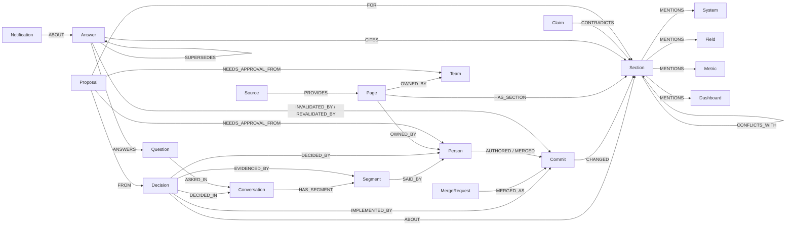

# HandbookBrain

**Graph Hacks 2026 · Track 3: Company Brain** · built on [FalkorDB](https://www.falkordb.com/)

Business decisions change every week: a lead-scoring threshold moves, a Deal Desk check is added, a partner renewal rule flips. The decision is made in a meeting or a Slack thread, the document is updated weeks later (or never), and everything that relied on the old rule (answers people were given, other docs, Salesforce fields, dashboards) silently goes wrong.

HandbookBrain keeps a **versioned knowledge graph** of a company's business and technical documents, the meetings and chats where decisions are made, and the systems, fields, metrics and dashboards those documents touch. On top of it, an agent:

1. **Answers "how does X work, and why?"** with a citation to the exact *version* of each section it used, and the trail back to the meeting where it was decided, who decided it, and the merge request that wrote it down.
2. **Detects what a change breaks.** When a section changes, it finds every stored answer that cited the old version, judges from the diff whether the answer is now wrong, notifies the page owners, and re-answers. It also lists every other document, field and dashboard that relies on what changed.
3. **Closes the gap between decision and documentation.** A decision made in a meeting that no document reflects after three weeks gets a drafted update, routed to the owner who must approve it. People approve; they do not have to remember to edit.

Without the graph none of this works: versioning, decision lineage and change impact are all multi-hop traversals (examples below).

---

## Demo story (real GitLab history, April–October 2026)

The `gitlab-gtm` company is GitLab's public handbook for go-to-market operations (Marketing Ops, Deal Desk, Sales Systems, Channel Ops, Marketing Analytics): **105 documents, 1,635 sections, 71 real merged MRs** replayed in date order. Meetings, Slack threads and tickets around them are synthetic (see *Data*).

| Date | What happened | What HandbookBrain did |
|---|---|---|
| Apr 1 | Graph built; the Marketo page has no trial scoring rule yet | 14 onboarding questions answered and watched. |
| May 8 | (synthetic) Marketing Ops weekly decides to add a trial scoring model | Decision extracted with speaker, quote and the section it is about. |
| May 21 | Real MR !19600 adds *Trial Threshold Scoring* to the Marketo page | Linked to the May 8 decision (decided → implemented, 13 days). |
| Jun 1 | A new Marketing Ops analyst asks *At how many points does a trial user MQL?* | Answered: **25 points**, citing that section version. |
| Jul 17 | (synthetic) Marketing Ops weekly decides to raise it | Decision extracted. |
| Jul 23 | Real MR !20534 changes `25` → `31` | The Jun 1 answer and two chat answers are judged **stale** from the diff, owners from CODEOWNERS notified, answers refreshed to **31**. Impact view: Marketo, the lead-score metric, every other doc that uses it. |

Other real changes in the same run: Order Type logic (!19475), FY27 Deal Registration (!15742), Initial Source logic (!20005), partner auto-renewal (!20249), opportunity-owner rule for XDRs (!20569), VAT ID validation (!21330), Deal Desk namespace check before contract-reset cancellation (!21365). Each one invalidated the answers that relied on the old text, and only those.

---

## Graph data model



Key ideas:

- **Section versions, not documents.** A page is split into sections; every change creates a new `Section` node (`vid = sid@hash`, `valid_from`/`valid_to`) that `SUPERSEDES` the previous one. Nothing is overwritten, so the graph can be read *as of any date*.
- **Answers are nodes.** An `Answer` `CITES` the exact section versions it used. That edge is what lets a later change find the answers it breaks.
- **Decisions are first-class.** Extracted from meetings / chat / tickets with the speaker and a verbatim quote, linked to the section they are about, and reconciled to the commit that implements them (an LLM judges the diff).
- **Business and technical layer.** Every section version `MENTIONS` the systems (Salesforce, Marketo, Zuora…), CRM fields (`Initial_Source__c`), metrics (MQL, ARR, lead score…) and BI dashboards it refers to. Extracted deterministically, so the graph also knows when a doc started or stopped referring to a field.
- **Provenance.** `Page.owner_source` (explicit / inferred / none), `origin` (human-authored / AI summary / AI-extracted / conversation), `Source.kind` (live / static) and `authority`.

All Cypher lives in `hb/graph.py`, `hb/queries.py` (agent tools), `hb/stale.py`, `hb/conversations.py`, `hb/entities.py`, `hb/crosscheck.py`, `hb/proposals.py` and `hb/story.py`.

## The Cypher that does the work

**1 · Why is it like this?** Answer → section version → change → decision → meeting, person, quote (`hb/queries.py: why_changed`)

```cypher
MATCH (s:Section {sid:$sid})<-[:CHANGED]-(c:Commit)<-[:IMPLEMENTED_BY]-(d:Decision)-[:DECIDED_IN]->(cv:Conversation)
OPTIONAL MATCH (d)-[e:EVIDENCED_BY]->(g:Segment)
OPTIONAL MATCH (d)-[:DECIDED_BY]->(by:Person)
RETURN DISTINCT d.statement AS decision, d.decided_at AS decided_at, cv.title AS meeting, cv.source AS source,
       by.name AS decided_by, c.ts AS implemented_at, d.lag_days AS lag_days,
       collect({speaker:g.speaker, at:g.at, text:left(g.text, 300)})[..3] AS evidence
```

**2 · Which answers did this change break?** (`hb/stale.py: _candidates`), then a diff-based judge decides material vs. wording-only

```cypher
MATCH (c:Commit {sha:$sha})-[ch:CHANGED]->(s:Section)
OPTIONAL MATCH (s)-[:SUPERSEDES]->(prev:Section)
WITH c, ch, s, CASE WHEN ch.kind = 'removed' THEN s ELSE prev END AS cited
WHERE cited IS NOT NULL
MATCH (a:Answer {status:'fresh'})-[:CITES]->(cited)
MATCH (a)-[:ANSWERS]->(qn:Question)
RETURN a.id, qn.text, ch.kind, cited.sid, cited.text AS old_text, s.text AS new_text
```

**3 · What else relies on what changed?** change → section → field / metric / dashboard → every other current document → owners (`hb/entities.py: impact_of_change`)

```cypher
MATCH (:Commit {sha:$sha})-[:CHANGED]->(s:Section)-[:MENTIONS]->(e)
MATCH (e)<-[:MENTIONS]-(o:Section)<-[:HAS_SECTION]-(p:Page)
WHERE o.valid_to IS NULL AND o.path <> s.path
OPTIONAL MATCH (p)-[:OWNED_BY]->(owner)
RETURN labels(e)[0] AS type, coalesce(e.name, e.url) AS name, p.title AS document,
       collect(DISTINCT owner.handle) AS owners
```

**4 · Decided, but not documented** (`hb/conversations.py: unimplemented`), which feeds the drafted update + approver routing in `hb/proposals.py`

```cypher
MATCH (d:Decision {status:'decided'})-[:DECIDED_IN]->(cv:Conversation)
WHERE d.epoch < $cutoff AND coalesce(d.changes_policy, true)
OPTIONAL MATCH (d)-[:ABOUT]->(s:Section)<-[:HAS_SECTION]-(p:Page)
OPTIONAL MATCH (p)-[:OWNED_BY]->(o)
RETURN d.statement, d.decided_at, cv.title, collect(DISTINCT o.handle) AS approvers
```

Retrieval for the agent is hybrid: FalkorDB **vector index** on `Section.embedding` + **full-text index** on `Section(heading, text)`, fused with reciprocal-rank fusion, restricted to current versions (`valid_to IS NULL`).

## How the agent works

`hb/answer.py`: a tool-calling loop over 10 parameterised Cypher tools (search, page details, section history with diffs, why-changed, decisions, who-knows, recent changes, conversations, systems-and-data, read-only Cypher). Guards:

- every claim must carry a cite key that a tool actually returned (checked in code);
- it must search at least twice before saying "the documents don't say";
- an **independent reviewer on a different model** sees only the question, the raw evidence and the draft, and can send it back;
- the answer is stored with `CITES` edges to the exact section versions, so it is watched from then on.

## Data

| Company (`companies/*.yaml`) | Documents | Conversations | Purpose |
|---|---|---|---|
| `gitlab-gtm` | Real GitLab handbook, GTM operations, 71 real MRs Apr–Oct 2026 | 68 synthetic (Zoom, Teams, Slack, tickets) anchored to real MRs | Main demo |
| `gitlab` | Real GitLab handbook, People / Total Rewards, 143 real MRs | 69 synthetic | Second domain, same code |
| `larkspur` | Fictional freight company, 22 docs in md / html / pdf / docx / txt / csv, a live wiki + a static shared drive | 55 in 13 native formats (Zoom vtt + captions, Teams vtt + chat, Meet, Slack, Google Chat, WhatsApp, Discord, eml, mbox, Jira CSV, notes incl. AI-written) | Unseen company, benchmark with hidden ground truth |

Onboarding a company is one YAML file (sources, scope, start date, conversation folder); no code changes. Only public or synthetic data is used. All synthetic people are fictional and every synthetic file carries `synthetic: true`.

## Results

**Larkspur Freight** (fictional company, ground truth never visible to the agent; `python -m hb --company larkspur bench`):

| | |
|---|---|
| Answers correct / correct or partial (41 questions) | 63% / 93% |
| Stale answers caught when the cited doc changed (question level) | 5 of 6, 1 false alarm |
| Live wiki vs. static PDF conflicts found on time | 8 of 9, 0 false alarms on 6 consistent sections, live source wins 8/8 |
| Meeting decisions linked to the change that implemented them | 7 of 8; undocumented decisions left open 3 of 3 |
| Unanswerable questions correctly declined | 3 of 3 |

**GitLab GTM replay**: 5 of the 8 synthetic meeting decisions were automatically linked to the real MR that implemented them (13 days for trial scoring, 6 days for the threshold change); 18 stored answers were invalidated by exactly the commits that changed what they cited (e.g. trial threshold 25 → 31, VAT validation, Deal Desk namespace check, owner rule for XDRs) and refreshed; wording-only and link-only changes were revalidated without alerts.

Honest caveats: the harness was tuned while looking at Larkspur results, so it is not a strict hold-out; one run per number; an LLM grades answers. Cost of a full GTM build + replay ≈ $2.5 with `gpt-4.1` / `gpt-4o-mini`.

## Quickstart

Requirements: Docker, Python ≥ 3.10, an OpenAI API key (Anthropic optional; LiteLLM is used).

```bash
git clone https://github.com/danhe6/handbookbrain && cd handbookbrain
bash setup.sh                      # clones the GitLab handbook (markdown only), starts FalkorDB, builds .venv
source .venv/bin/activate
# put OPENAI_API_KEY in .env

C="--company gitlab-gtm"
python -m hb $C doctor
python -m hb $C init --reset                              # graph as of 2026-04-01
python -m hb $C seed eval/questions-gtm.txt               # questions asked on Apr 1
python -m hb $C replay --quiet --until 2026-06-01         # replay real MRs + synthetic meetings/chat
python -m hb $C seed eval/questions-gtm-june.txt          # questions asked on Jun 1
python -m hb $C replay --quiet                            # the rest: watch answers go stale
python -m hb $C refresh --gaps                            # re-answer stale answers, retry gaps
python -m hb $C serve                                     # UI + API on http://localhost:8000
```

FalkorDB Browser is on http://localhost:3000 (graph `gitlab-gtm`). Other useful commands: `ask "…"`, `alerts`, `decisions`, `sources`, `stale`, `stats`, `sync` (daily job), `upload FILES`, `bench`. The synthetic conversations are committed, so `synth` is optional.

Programmatic use: every UI view is a JSON endpoint (`/api/ask`, `/api/story/{answer}`, `/api/impact/{commit}`, `/api/review`, `/api/proposals`, `/api/graph/*`); see `hb/api.py`.

## UI

- **Overview**: what it does, the loop, and the live data model read from FalkorDB.
- **Demo**: ask, or open an answer it is already watching: cited answer, the answer's subgraph, and a timeline (decided in which meeting by whom → which MR changed which section → what that change affected → answer given / invalidated / refreshed).
- **Explore graph**: documents clustered by owning team, decisions and meetings, shared fields / metrics / dashboards; drill into one document's versions; changes by area over time.
- **Review**: stale answers, sources that disagree, decided-not-documented (with *Draft update* → approver), drafted updates, chat statements that contradict the docs, knowledge gaps.
- **Capabilities**: sources (live / static, connect or upload), company config, models and cost controls, benchmark.

## Limitations and next steps

- Monitors decisions and documents, not the business data itself (dashboard values); next: a Snowflake / dbt connector so a field or model change is a change event too.
- Conversations are read from native exports; direct OAuth connectors (Slack, Zoom, Drive) and speech-to-text for recordings are next.
- Approving a drafted update records the sign-off and the patch; opening the MR in the source system is next.
- Company-specific playbooks generated from the company's own process docs, to guide the agent's search.

## AI assistance disclosure

This project was built with an AI coding assistant (Claude, by Anthropic) that wrote most of the code, prompts and this README under the author's direction, design decisions and review. At runtime the product calls OpenAI models (`gpt-4.1`, `gpt-4o-mini`, `text-embedding-3-small`) through LiteLLM. Synthetic meetings, chats and the fictional Larkspur company were generated with `gpt-4.1`.

## License

MIT. GitLab handbook content is © GitLab and used under its CC BY-SA 4.0 license; it is cloned at setup time, not redistributed here.
