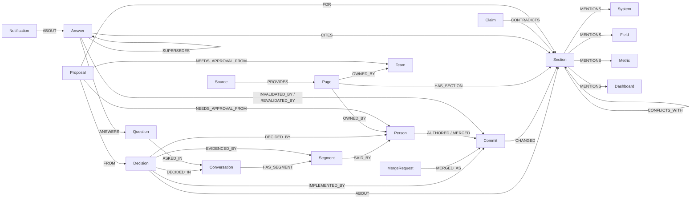

# HandbookBrain

[](https://youtu.be/-JE9sZrTwm8)

**Graph Hacks 2026 · Track 3: Company Brain** · built on [FalkorDB](https://www.falkordb.com/)

Business decisions change every week: a lead-scoring threshold moves, a Deal Desk check is added, a partner renewal rule flips. The decision is made in a meeting or a Slack thread, the document is updated weeks later (or never), and everything that relied on the old rule (answers people were given, other docs, Salesforce fields, dashboards) silently goes wrong.

HandbookBrain keeps a **versioned knowledge graph** of a company's business and technical documents, the meetings and chats where decisions are made, and the systems, fields, metrics and dashboards those documents touch. On top of it, an agent:

1. **Answers "how does X work, and why?"** with a citation to the exact *version* of each section it used, and the trail back to the meeting where it was decided, who decided it, and the merge request that wrote it down.
2. **Detects what a change breaks.** When a section changes, it finds every stored answer that cited the old version, judges from the diff whether the answer is now wrong, notifies the page owners, and re-answers. It also lists every other document, field and dashboard that relies on what changed.
3. **Closes the gap between decision and documentation.** A decision made in a meeting that no document reflects after three weeks gets a drafted update, routed to the owner who must approve it. People approve; they do not have to remember to edit.

Without the graph none of this works: versioning, decision lineage and change impact are all multi-hop traversals (examples below).

**At a glance**

- **Demo video (2.5 min)**: [youtu.be/-JE9sZrTwm8](https://youtu.be/-JE9sZrTwm8) · run it yourself: [Quickstart](#quickstart)
- **What the graph adds, measured** ([details](#how-we-evaluated-the-agent)): plain retrieval finds the meeting where something
  was decided as well as we do. Linking that decision to the change that implemented it is where the graph matters:
  18 of 18 answers name the right merge request, vs 4 of 18 for RAG given the full git log. Version questions
  (old value, new value, when) 15 of 15 vs 9 of 15. Over all 29 questions: 87% vs 66% (RAG + git log) and 59% (plain RAG).
  On plain lookups the graph adds nothing (70% for all three).
- **Everything on the site is checked against an independent source** ([audit](#how-we-verified-it)): 2562/2562 change dates
  vs git, 21/21 decisions vs transcripts, 122/122 owners vs CODEOWNERS, 0 wrong decision → change links.
- **Five views**: Ask (answers with the decision trail and the agent's steps), Learn (onboarding by asking), Explore
  (the company graph by domain, decisions triaged by kind and impact), Review (drafted updates, owners approve), How it works.

---

## Demo story (real GitLab history, April–October 2026)

The `gitlab-gtm` company is GitLab's public handbook for go-to-market operations (Marketing Ops, Deal Desk, Sales Systems, Channel Ops, Marketing Analytics): **105 documents, 1,635 sections, 71 real merged MRs** replayed in date order. Meetings, Slack threads and tickets around them are synthetic (see *Data*).

| Date | What happened | What HandbookBrain did |
|---|---|---|
| Apr 1 | Graph built; the Marketo page has no trial scoring rule yet | 14 onboarding questions answered and watched. |
| May 8 | (synthetic) Marketing Ops weekly decides to add a trial scoring model | Decision extracted with speaker, quote and the section it is about. |
| May 21 | Real MR !19600 adds *Trial Threshold Scoring* to the Marketo page | Linked to the May 8 decision (decided → implemented, 13 days). |
| Jun 1 | A new Marketing Ops analyst asks *At how many points does a trial user MQL?* | Answered: **25 points**, citing that section version. |
| Jul 17 | (synthetic) Marketing Ops weekly decides to raise it | Decision extracted. |
| Jul 23 | Real MR !20534 changes `25` → `31` | The Jun 1 answer and two chat answers are judged **stale** from the diff, owners from CODEOWNERS notified, answers refreshed to **31**. Impact view: Marketo, the lead-score metric, every other doc that uses it. |

Other real changes in the same run: Order Type logic (!19475), FY27 Deal Registration (!15742), Initial Source logic (!20005), partner auto-renewal (!20249), opportunity-owner rule for XDRs (!20569), VAT ID validation (!21330), Deal Desk namespace check before contract-reset cancellation (!21365). Each one invalidated the answers that relied on the old text, and only those.

---

## Graph data model



Key ideas:

- **Section versions, not documents.** A page is split into sections; every change creates a new `Section` node (`vid = sid@hash`, `valid_from`/`valid_to`) that `SUPERSEDES` the previous one. Nothing is overwritten, so the graph can be read *as of any date*.
- **Answers are nodes.** An `Answer` `CITES` the exact section versions it used. That edge is what lets a later change find the answers it breaks.
- **Decisions are first-class.** Extracted from meetings / chat / tickets with the speaker and a verbatim quote, linked to the section they are about, and reconciled to the commit that implements them (an LLM judges the diff).
- **Business and technical layer.** Every section version `MENTIONS` the systems (Salesforce, Marketo, Zuora…), CRM fields (`Initial_Source__c`), metrics (MQL, ARR, lead score…) and BI dashboards it refers to. Extracted deterministically, so the graph also knows when a doc started or stopped referring to a field.
- **Provenance.** `Page.owner_source` (explicit / inferred / none), `origin` (human-authored / AI summary / AI-extracted / conversation), `Source.kind` (live / static) and `authority`.

All Cypher lives in `hb/graph.py`, `hb/queries.py` (agent tools), `hb/stale.py`, `hb/conversations.py`, `hb/entities.py`, `hb/crosscheck.py`, `hb/proposals.py` and `hb/story.py`.

## The Cypher that does the work

**1 · Why is it like this?** Answer → section version → change → decision → meeting, person, quote (`hb/queries.py: why_changed`)

```cypher
MATCH (s:Section {sid:$sid})<-[:CHANGED]-(c:Commit)<-[:IMPLEMENTED_BY]-(d:Decision)-[:DECIDED_IN]->(cv:Conversation)
OPTIONAL MATCH (d)-[e:EVIDENCED_BY]->(g:Segment)
OPTIONAL MATCH (d)-[:DECIDED_BY]->(by:Person)
RETURN DISTINCT d.statement AS decision, d.decided_at AS decided_at, cv.title AS meeting, cv.source AS source,
       by.name AS decided_by, c.ts AS implemented_at, d.lag_days AS lag_days,
       collect({speaker:g.speaker, at:g.at, text:left(g.text, 300)})[..3] AS evidence
```

**2 · Which answers did this change break?** (`hb/stale.py: _candidates`), then a diff-based judge decides material vs. wording-only

```cypher
MATCH (c:Commit {sha:$sha})-[ch:CHANGED]->(s:Section)
OPTIONAL MATCH (s)-[:SUPERSEDES]->(prev:Section)
WITH c, ch, s, CASE WHEN ch.kind = 'removed' THEN s ELSE prev END AS cited
WHERE cited IS NOT NULL
MATCH (a:Answer {status:'fresh'})-[:CITES]->(cited)
MATCH (a)-[:ANSWERS]->(qn:Question)
RETURN a.id, qn.text, ch.kind, cited.sid, cited.text AS old_text, s.text AS new_text
```

**3 · What else relies on what changed?** change → section → field / metric / dashboard → every other current document → owners (`hb/entities.py: impact_of_change`)

```cypher
MATCH (:Commit {sha:$sha})-[:CHANGED]->(s:Section)-[:MENTIONS]->(e)
MATCH (e)<-[:MENTIONS]-(o:Section)<-[:HAS_SECTION]-(p:Page)
WHERE o.valid_to IS NULL AND o.path <> s.path
OPTIONAL MATCH (p)-[:OWNED_BY]->(owner)
RETURN labels(e)[0] AS type, coalesce(e.name, e.url) AS name, p.title AS document,
       collect(DISTINCT owner.handle) AS owners
```

**4 · Decided, but not documented** (`hb/conversations.py: unimplemented`), which feeds the drafted update + approver routing in `hb/proposals.py`

```cypher
MATCH (d:Decision {status:'decided'})-[:DECIDED_IN]->(cv:Conversation)
WHERE d.epoch < $cutoff AND coalesce(d.changes_policy, true)
OPTIONAL MATCH (d)-[:ABOUT]->(s:Section)<-[:HAS_SECTION]-(p:Page)
OPTIONAL MATCH (p)-[:OWNED_BY]->(o)
RETURN d.statement, d.decided_at, cv.title, collect(DISTINCT o.handle) AS approvers
```

Retrieval for the agent is hybrid: FalkorDB **vector index** on `Section.embedding` + **full-text index** on `Section(heading, text)`, fused with reciprocal-rank fusion, restricted to current versions (`valid_to IS NULL`).

## How the agent works

`hb/answer.py`: a tool-calling loop over 10 parameterised Cypher tools (search, page details, section history with diffs, why-changed, decisions, who-knows, recent changes, conversations, systems-and-data, read-only Cypher). Guards:

- every claim must carry a cite key that a tool actually returned (checked in code);
- it must search at least twice before saying "the documents don't say";
- an **independent reviewer on a different model** sees only the question, the raw evidence and the draft, and can send it back;
- the answer is stored with `CITES` edges to the exact section versions, so it is watched from then on.
- search is hybrid (vector + full-text + section headings, fused) and also returns **older versions** of a section that
  said something the current one no longer does, with the MR that removed it; tables are read row by row;
- the Ask page shows, under each answer, the agent's tool calls and any time the reviewer sent it back.

## Data

| Company (`companies/*.yaml`) | Documents | Conversations | Purpose |
|---|---|---|---|
| `gitlab-gtm` | Real GitLab handbook, GTM operations, 71 real MRs Apr–Oct 2026 | 68 synthetic (Zoom, Teams, Slack, tickets) anchored to real MRs | Main demo |
| `gitlab` | Real GitLab handbook, People / Total Rewards, 143 real MRs | 69 synthetic | Second domain, same code |
| `larkspur` | Fictional freight company, 22 docs in md / html / pdf / docx / txt / csv, a live wiki + a static shared drive | 55 in 13 native formats (Zoom vtt + captions, Teams vtt + chat, Meet, Slack, Google Chat, WhatsApp, Discord, eml, mbox, Jira CSV, notes incl. AI-written) | Unseen company, benchmark with hidden ground truth |

Onboarding a company is one YAML file (sources, scope, start date, conversation folder); no code changes. Only public or synthetic data is used. All synthetic people are fictional and every synthetic file carries `synthetic: true`.

## Results

**Larkspur Freight** (fictional company, ground truth never visible to the agent; `python -m hb --company larkspur bench`):

| | |
|---|---|
| Answers correct / correct or partial (41 questions) | 63% / 93% |
| Stale answers caught when the cited doc changed (question level) | 5 of 6, 1 false alarm |
| Live wiki vs. static PDF conflicts found on time | 8 of 9, 0 false alarms on 6 consistent sections, live source wins 8/8 |
| Meeting decisions linked to the change that implemented them | 7 of 8; undocumented decisions left open 3 of 3 |
| Unanswerable questions correctly declined | 3 of 3 |

**GitLab GTM replay**: 6 of the 8 synthetic meeting decisions are linked to the real MR that implemented them (5 exactly, 1 to its same-day sibling MR; see the audit below), originally 5 of 8 after replay (13 days for trial scoring, 6 days for the threshold change); 18 stored answers were invalidated by exactly the commits that changed what they cited (e.g. trial threshold 25 → 31, VAT validation, Deal Desk namespace check, owner rule for XDRs) and refreshed; wording-only and link-only changes were revalidated without alerts.

Honest caveats: the harness was tuned while looking at Larkspur results, so it is not a strict hold-out; one run per number; an LLM grades answers. Cost of a full GTM build + replay ≈ $2.5 with `gpt-4.1` / `gpt-4o-mini`.


## How we verified it

Everything the site says is checked against an **independent source**, not against the graph itself:
`python -m hb --company gitlab-gtm audit` writes `runs/gitlab-gtm/audit.md` with every failing row listed.

| | Check | Source of truth | Result |
|---|---|---|---|
| A | Dates of every change, MR number, section version and version chain | `git log` of the handbook repo | **2562 / 2562** |
| B | Meeting decision → the MR that implemented it | `labels.json` (never read by the agent) | **8 / 11** exact (incl. 3 / 3 undocumented decisions correctly left open), 1 linked to the same-day sibling MR, **0 wrong links** |
| C | Who decided, in which meeting, on what date, the verbatim quote | meeting transcripts | **21 / 21** |
| D | Document owners | `CODEOWNERS` at HEAD | **122 / 122** |
| E | Systems / metrics / fields a section "mentions" really occur in it | section text | **1696 / 1696** |
| F | Domain of every node | the document's folder | pass |
| G | Triage reasons ("MQL is used in 24 other documents") | recomputed from raw text | **14 / 14** |
| H | Demo answers name the right MR, meeting date and person | `labels.json` | **5 / 5** |
| I | Documents and change counts on the site | git | **122 / 122** documents |
| J | Glossary definitions come from a section that contains the term | section text | **8 / 8** |
| K | Every number / date / name in the Learn briefs occurs in the data | graph | 39 / 41 (2 are sub-headings, not facts) |

What the audit caught and we fixed: an over-lenient decision → MR judge that linked 3 decisions to later, unrelated
changes (now: only what changed in the diff counts, plus a same-day sibling window; wrong links pruned and the audit
checks for extra links); stale entity mentions after a section changed; a "why" answer that took the decision from the
wrong section (decisions are now looked up for the question itself and pinned to the exact version they changed); a
reviewer that pushed an unrelated decision in as the reason (it may no longer ask for reasons the evidence doesn't state).

The 2 remaining misses in B are labelled-data issues, checked with `git show`: the synthetic meeting decision was written
from the MR title but the MR's diff does something else (!21365 adds namespace verification; the meeting decided a
purchaser rule), so refusing the link is correct. A model-graded "every claim supported" check on the demo answers is
reported in the audit as advisory only: it varies between runs.

## How we evaluated the agent

The audit above checks the graph. This checks the **agent**: does it answer correctly and consistently, and what does
the graph add over ordinary retrieval? `python -m hb --company gitlab-gtm evalagent` (approach from Anthropic's
[Demystifying evals for AI agents](https://www.anthropic.com/engineering/demystifying-evals-for-ai-agents): code graders
where possible, a model judge only for open answers, should-answer and should-decline cases, repeated trials).

**Setup.** 29 questions (`eval/gitlab-gtm/questions.jsonl`) with gold facts from sources the agent does not read
directly: `labels.json` for meetings and MRs, `git show` diffs for what changed, real ticket wording for lookups.
3 independent trials each, LLM cache off. Same model (`gpt-4.1`) for every system. Two baselines, no graph traversal:
- **Plain RAG**: the same hybrid vector + keyword retrieval over current handbook sections and meeting/chat transcripts.
- **RAG + git log**: the same, plus the repository's merge log as text (MR number, date, title, description, files touched).

**Where the systems differ: individual facts, all trials** (6 "why did X change, who decided" questions, 5 "what changed" questions):

| Fact the answer must contain | HandbookBrain | RAG + git log | Plain RAG |
|---|---|---|---|
| Meeting date of the decision | 18 / 18 | 18 / 18 | 18 / 18 |
| Who decided / which meeting | 18 / 18 | 15 / 18 | 14 / 18 |
| **The MR that implemented the decision** | **18 / 18** | 4 / 18 | 0 / 18 (not in its data) |
| Current or previous value of a changed rule | 15 / 15 | 9 / 15 | 6 / 15 |
| When it changed | 3 / 3 | 3 / 3 | 0 / 3 |

Read honestly: finding the meeting where something was decided is a retrieval problem, and plain retrieval does it as
well as we do. What the graph adds is the **link from that decision to the change that implemented it** (precomputed at
ingest by reading each diff, audited in check B above) and the **version history** of each section, including rules that
were deleted. Given the whole merge log as text, the model rarely matches a meeting to the right MR on its own (4 of 18).

**All 29 questions** (pass = every required fact, or the judge's "correct"; pass^3 = passes in all 3 trials):

| Question type | Q | HandbookBrain pass / pass^3 | RAG + git log | Plain RAG |
|---|---|---|---|---|
| Why did X change, who decided | 6 | 100% / 100% | 17% / 17% | 0% / 0% (cannot name the MR) |
| What changed over time | 5 | 87% / 80% | 60% / 60% | 40% / 40% |
| Decided in a meeting, never documented | 3 | 100% / 100% | 100% / 100% | 100% / 100% |
| Employee lookups (one handbook section) | 10 | 70% / 70% | 70% / 70% | 70% / 70% |
| Not in the documents: must decline | 4 | 100% / 100% | 100% / 100% | 100% / 100% |
| Only said in chat | 1 | 100% / 100% | 100% / 100% | 100% / 100% |
| **All** | 29 | **87% / 86%** | 66% / 66% | 59% / 59% |

**Limits, stated plainly.**
- On **lookups the graph adds nothing**: all three systems score 70%. The agent cites the exact gold section 90% of the
  time, but its answers sometimes add details from other sections that the judge marks "partial".
- It is **slower and dearer**: 6.1 s and ~3¢ per answer vs ~1.9 s and ~0.4¢ for the baselines.
- The sample is **small and ours**: 29 questions written by us on one dataset, and we fixed the agent after reading its
  failures on these same questions (below). Expect lower numbers on new questions; the gap on "why" and "what changed"
  comes from data the baselines do not have (decision → MR links, section versions), so it should hold better than the rest.
- Retrieval fixes (section windows, table linearisation, heading matches) live in the shared search code, so the
  baselines got them too.

**What the eval changed in the agent** (run 1 → final: 62% → 87%): a section whose heading names the question
("Trial Threshold Scoring") was buried by full-text scoring under a generic "MQL and Lead Scoring" (100 points), so the agent
answered 100 instead of 31 (heading-match candidates added); wide markdown tables were misread by column (rows are now
linearised: "Renewal timing → Tier 1: 6 months; Tier 2: 4 months"); rules deleted from a page were invisible (search now
returns older versions that said more, with the MR that removed them); chat search ranked small talk first (re-ranked,
and decisions recorded in conversations are returned); the agent named owners that were not in the evidence (forbidden now);
short sections were cut to their best-matching list item and lost the answer (now returned whole); a rule agreed only in
chat was presented as policy with a handbook citation (decisions nobody implemented are now marked "only in a chat
thread / meeting", and the agent must say so); the agent answered from chat when a document said the same thing
(conversation search now shows the best-matching documents first).
One gold item was wrong (the ticket asked about browser tabs, which its labelled section does not cover) and was rewritten.
Full report with every failure: `eval/gitlab-gtm/results.md`; per-answer data: `eval/gitlab-gtm/results.json`.

## Onboarding: the new-hire view

A new hire gets one link. The **Learn** tab has a start page per area (scope folder or department), built from the graph:
an AI-written one-page orientation (from that area's documents and decisions only, cached per sync), who to ask (owners
and decision-makers), how the area evolved (decision → meeting → MR timeline), the systems / metrics / dashboards / fields
it runs on, the area subgraph, and documents to read first (ranked by inbound links, recent changes and entity references).

- **Glossary in place**: recurring acronyms plus the System/Metric entities are underlined wherever they appear (answers,
  timelines, documents). A definition is written once, from the 3 sections that best explain the term, and stored as
  `(:Term)-[:DEFINED_IN]->(:Section)`; it is labelled when the docs only use the term without defining it.
- **Ask about this**: on any decision, change, document, section, node or term. The context is that node's neighbourhood
  in the graph (e.g. a decision → the meeting excerpt, the MR diff, the fields it touches), answered in plain words with sources.

`python -m hb --company gitlab-gtm learn` pre-writes the briefs and glossary so the page is instant.

## Quickstart

Requirements: Docker, Python ≥ 3.10, an OpenAI API key (Anthropic optional; LiteLLM is used).

```bash
git clone https://github.com/danhe6/handbookbrain && cd handbookbrain
bash setup.sh                      # clones the GitLab handbook (markdown only), starts FalkorDB, builds .venv
source .venv/bin/activate
# put OPENAI_API_KEY in .env

C="--company gitlab-gtm"
python -m hb $C doctor
python -m hb $C init --reset                              # graph as of 2026-04-01
python -m hb $C seed eval/questions-gtm.txt               # questions asked on Apr 1
python -m hb $C replay --quiet --until 2026-06-01         # replay real MRs + synthetic meetings/chat
python -m hb $C seed eval/questions-gtm-june.txt          # questions asked on Jun 1
python -m hb $C replay --quiet                            # the rest: watch answers go stale
python -m hb $C refresh --gaps                            # re-answer stale answers, retry gaps
python -m hb $C serve                                     # UI + API on http://localhost:8000
```

FalkorDB Browser is on http://localhost:3000 (graph `gitlab-gtm`). Other useful commands: `ask "…"`, `alerts`, `decisions`, `sources`, `stale`, `stats`, `sync` (daily job), `upload FILES`, `bench`. The synthetic conversations are committed, so `synth` is optional.

Programmatic use: every UI view is a JSON endpoint (`/api/ask`, `/api/story/{answer}`, `/api/impact/{commit}`, `/api/review`, `/api/proposals`, `/api/graph/*`); see `hb/api.py`.

## UI

One place for the whole company, organised by who is using it:

- **Overview**: the idea (all company knowledge in one versioned graph), a short clip of each feature recorded from the live app with a *Try it* link, the closed loop, the live data model and benchmark numbers.
- **Ask** (everyone): ask, or open an answer it is already watching: cited answer, the answer's subgraph, and a timeline (decided in which meeting by whom → which MR changed which section → what that change affected → answer given / invalidated / refreshed).
- **Learn** (new hires): pick an area and ask; starter questions open one card at a time (overview, recent decisions, who to ask, tools and metrics, what to read, glossary, map), lists start short and expand on demand. Terms explain themselves; *Ask about this* works on anything.
- **Explore** (analysts, leads): the company graph with **domain focus**: pick a domain and only its documents, decisions, meetings, people, metrics, dashboards and fields are laid out. Below the graph, a decision timeline (meeting → who → the MR that made it official) follows the same domain focus and is linked to the graph both ways. **Decision triage** (`hb/triage.py`): each decision is labelled *Business rule / Process / System & data* (a model that sees the decision and its graph neighbours) and ranked *high / medium / low impact* from the graph itself — metrics, fields and dashboards it touches, how many other documents rely on them, answers given from the section, domains crossed, owners — with the graph facts shown as the reason. The same labels sort Learn's "what changed" and Review's decided-not-documented queue. Every graph in the app (answer trails included) carries node domains, computed from where documents live and propagated along the graph but not through shared hubs like Salesforce.
- **Review** (owners): stale answers, sources that disagree, decided-not-documented (with *Draft update* → approver), drafted updates, chat statements that contradict the docs, knowledge gaps.
- **Setup**: sources (live / static, connect or upload), company config, models and cost controls, benchmark.

Feature clips: `pip install playwright && python -m playwright install chromium`, start `serve`, then `python scripts/record_demos.py` (writes `web/media/*.webm`; each scene runs once to warm caches, then is recorded with a visible cursor; nothing is approved or changed).

## Responsible AI

- **Grounded or silent.** Every claim carries a citation to an exact section version that a tool returned (checked in code);
  otherwise the answer starts with "The handbook doesn't say." It may not name an owner, team or reason the evidence does not contain.
- **Two models.** A reviewer on a different model sees only the question, the raw evidence and the draft, and can send it back.
- **Trust levels are visible.** Meeting and chat content is labelled as conversation, not policy; AI-written meeting notes
  are flagged; static uploads lose to live, maintained sources and are called out as outdated.
- **People decide.** The agent drafts documentation updates; only the page owner (from CODEOWNERS) can approve them.
  Other people's sign-offs are recorded as endorsements.
- **Audited and evaluated** against sources the agent never reads (git, transcripts, CODEOWNERS, labels), with failures listed, not hidden.
- **Data.** Public GitLab handbook history plus synthetic meetings and chats; all synthetic people are fictional and every
  synthetic file carries `synthetic: true`. No personal data.

## Limitations and next steps

- Monitors decisions and documents, not the business data itself (dashboard values); next: a Snowflake / dbt connector so a field or model change is a change event too.
- Conversations are read from native exports; direct OAuth connectors (Slack, Zoom, Drive) and speech-to-text for recordings are next.
- Approving a drafted update records the sign-off and the patch; opening the MR in the source system is next.
- Company-specific playbooks generated from the company's own process docs, to guide the agent's search.

## AI assistance disclosure

This project was built with an AI coding assistant (Claude, by Anthropic) that wrote most of the code, prompts and this README under the author's direction, design decisions and review. At runtime the product calls OpenAI models (`gpt-4.1`, `gpt-4o-mini`, `text-embedding-3-small`) through LiteLLM. Synthetic meetings, chats and the fictional Larkspur company were generated with `gpt-4.1`.

## License

MIT. GitLab handbook content is © GitLab and used under its CC BY-SA 4.0 license; it is cloned at setup time, not redistributed here.
